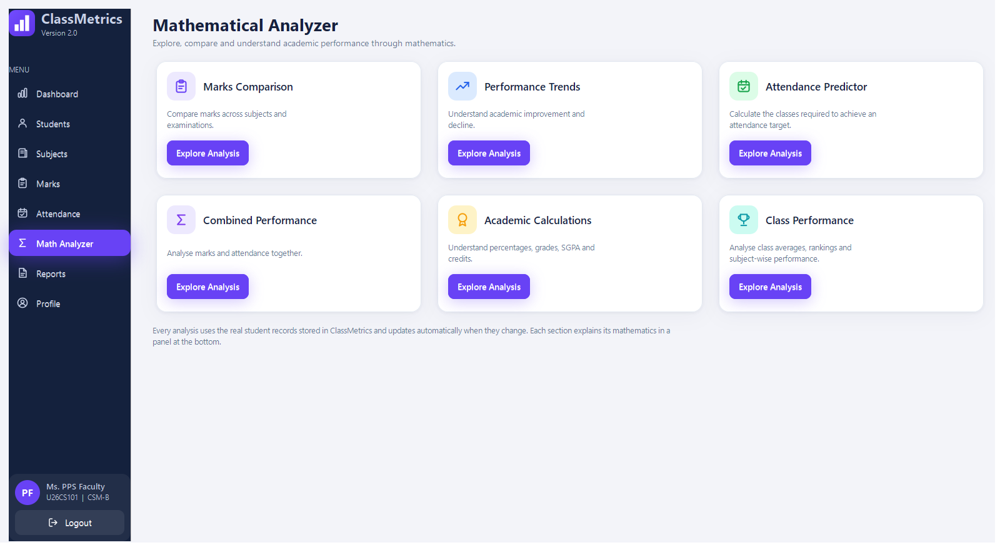
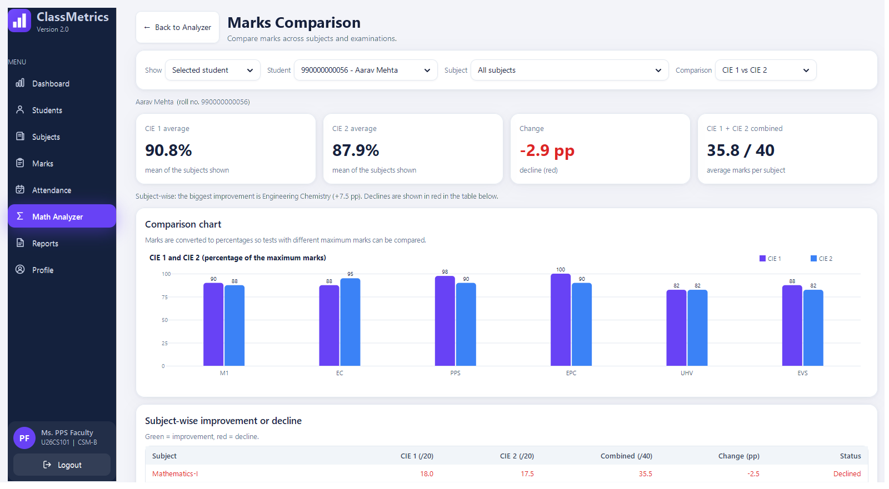
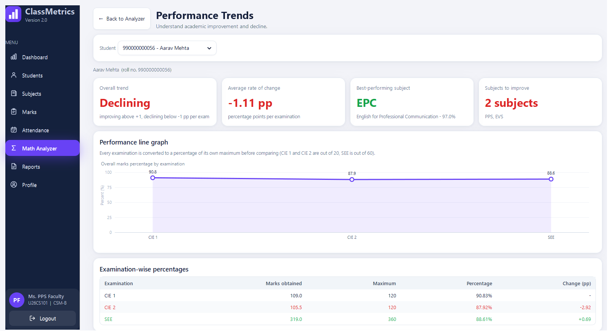
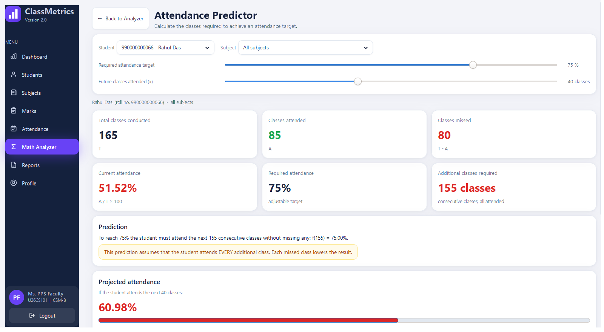
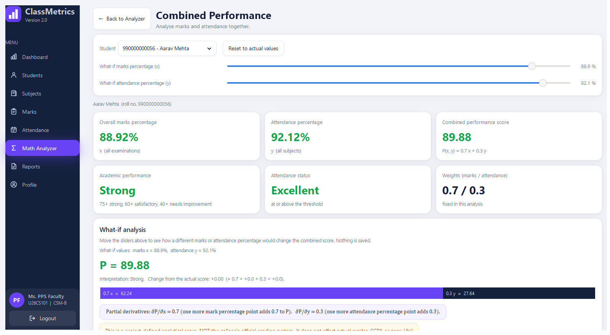
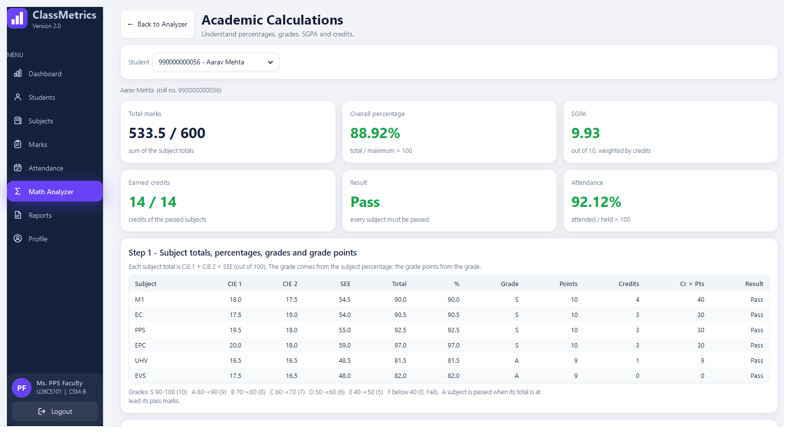
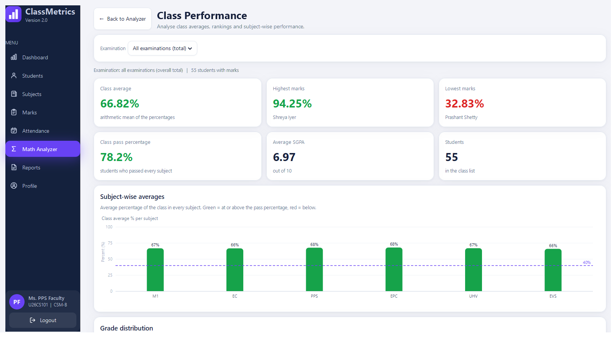
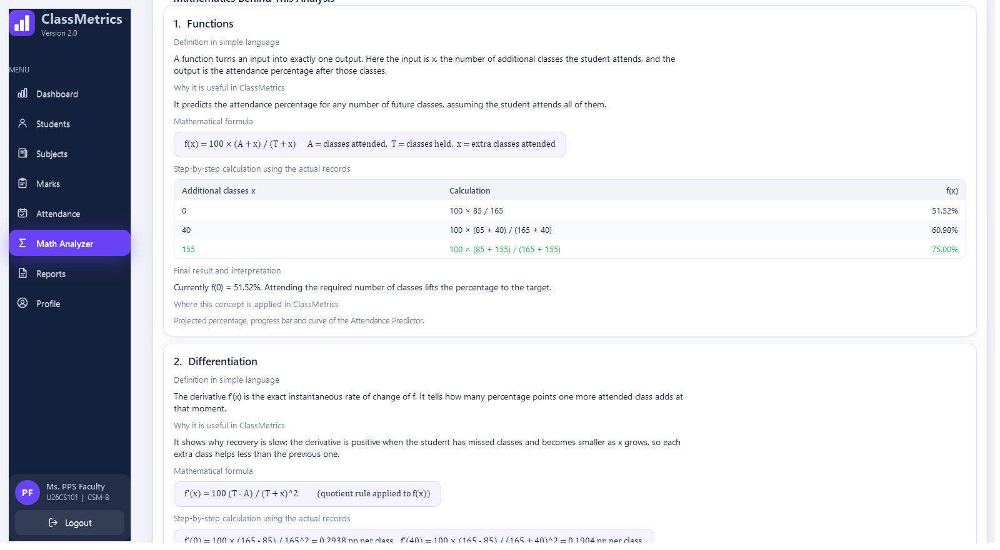

# ClassMetrics - Student Marks & Attendance Analyzer

A C-based Student Marks and Attendance Analyzer integrating Mathematics-I and Programming for Problem Solving concepts using GTK3.

> **Platform:** the current application is a **Windows desktop application** written in C with GTK3.
> An Android version is **planned for future development but has not been implemented yet.**

## Introduction

ClassMetrics stores the records of a class (students, subjects, examinations, marks and attendance) and calculates results automatically:
subject totals, percentages, grades, SGPA, pass / fail, class ranking and attendance warnings. It was built as an integrated mini project for
**Mathematics-I** and **Programming for Problem Solving (PPS)**. All student data in this repository is fictional demonstration data.

## Problem statement

Teachers who manage marks and attendance by hand spend a lot of time on repeated calculations, risk arithmetic errors, find it hard to keep
period-wise attendance consistent, and cannot quickly see which students are weak or short of attendance. ClassMetrics automates these tasks.

## Objectives

- Simplify student record management.
- Automate marks, percentage, grade, SGPA and result calculation.
- Manage period-wise attendance with subject locking.
- Identify academically weak students and students with attendance shortage.
- Analyse student and class performance.
- Apply Mathematics-I concepts practically to real records.
- Implement the application in C using PPS concepts.

## Main features

- **Login** (local demonstration account) and a **Dashboard** with class statistics and charts.
- **Students**: add, edit, delete, search, sort, CSV import.
- **Subjects**: six subjects with faculty, credits and syllabus units.
- **Marks**: marks sheet, ranking and summary, View Student window, Edit Marks, spreadsheet-style CSV export / import. Three examinations per
  subject: CIE 1 (20), CIE 2 (20) and SEE (60). Grades S to F, SGPA, pass if every subject is passed.
- **Attendance**: period-wise sessions (1-8), subject locking, duplicate prevention, history, summary with a low-attendance threshold, CSV export.
- **Reports** with CSV export and a faculty **Profile** page.
- Small optional interface animations (can be switched off in the Profile page).

## Mathematical Analyzer

A home page with six sections; each has a collapsed "Mathematics Behind This Analysis" panel with definitions, formulas and a worked example
using the stored records.

| Section | What it does |
|---|---|
| Marks Comparison | CIE 1 vs CIE 2, combined marks, improvement / decline, class-wide option, full-matrix window |
| Performance Trends | Percentages per examination, rate of change, best subject, subjects to improve |
| Attendance Predictor | Classes needed to reach an attendance target using f(x) = 100 (A + x) / (T + x) |
| Combined Performance | Project-defined score P(x, y) = 0.7x + 0.3y with what-if sliders |
| Academic Calculations | Step-by-step totals, percentage, grades, SGPA, credits, result |
| Class Performance | Class average, highest / lowest, pass %, grade distribution, top students, students needing attention |

**Mathematics concepts implemented:** matrices (representation, addition, subtraction, transpose), functions, rate of change and finite
differences, differentiation (derivative of the attendance function), inequalities, functions of two variables, partial derivatives, weighted
functions, summation, weighted averages, arithmetic mean, maximum / minimum, percentages and frequency distributions.
The combined score is a project-defined model, not an official grading rule, and never changes grades, SGPA or pass / fail.
A finite difference is an approximation, not differentiation. Other Mathematics-I topics (for example rank of a matrix, Taylor series,
Jacobian, integration) are **not** implemented.

## C programming concepts implemented

Structures (`Student`, `Subject`, `MarkRec`, `AttRec`, ...), one- and two-dimensional arrays, strings, pointers, function pointers and GTK
callbacks, loops, conditions, `switch`, functions, preprocessor directives, linear search, insertion sort and selection sort, and file handling
(CSV). Recursion and unions are not used. The logic layer uses fixed-size arrays; GLib `g_malloc` is used only for small interface helpers.

## Technologies

C (gnu99), GTK 3 (3.24), Cairo, GCC and `make` (MSYS2 MinGW64 on Windows), plain CSV files for storage. No database, cloud service or AI model.

## Project structure

```
common.h  storage.c  students.c  subjects.c  marks.c  attendance.c  math_analyzer.c  reports.c   (logic layer, no GTK)
main.c  login.c  dashboard.c  ui_*.c  ui.h                                                       (GTK interface)
data/                CSV demonstration data (fictional)
tests/test_logic.c   console tests of the logic layer
docs/images/         Mathematical Analyzer screenshots
Makefile  build.bat  run.bat
```

## System requirements

- Windows 10 or later (64-bit)
- [MSYS2](https://www.msys2.org/) with the MinGW64 toolchain, GTK 3 and `make`:
  `pacman -S mingw-w64-x86_64-gcc mingw-w64-x86_64-gtk3 mingw-w64-x86_64-pkg-config make`

## Compile and run

1. Install MSYS2 and the packages above (default location `C:\msys64`).
2. Double-click `build.bat` (or run `make` in the MSYS2 MinGW64 shell).
3. Double-click `run.bat` to start the application.
4. A demonstration login account is created automatically on the first start (see the hint on the login window).

Run the logic tests: `make test` (current result: 1022 checks, 0 failed).

## Data note

All students, marks and attendance records are fictional demonstration data. The login account is a simple local demonstration account and
is not secure; this is a classroom project, not production software.

## Screenshots (Mathematical Analyzer)

| | |
|---|---|
|  |  |
|  |  |
|  |  |
|  |  |
